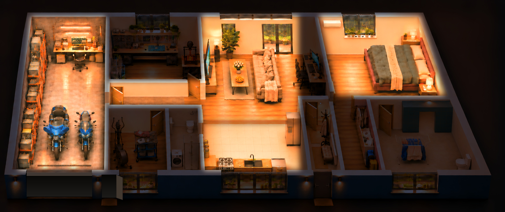

# Floor Plan Card (mapa domu) dla Home Assistant

Karta Lovelace z planem domu. Pokój świeci, kiedy jego światło jest włączone,
brama garażowa i drzwi pokazują, czy są otwarte. Kliknięcie ikony przełącza
światło albo bramę, przytrzymanie otwiera szczegóły encji.



## Instalacja przez HACS

1. HACS → menu (trzy kropki) → **Custom repositories**.
2. Repozytorium: `https://github.com/voltronicpl/ha-floor-plan-card`, typ: **Dashboard** (Lovelace).
3. Znajdź „Floor Plan Card (mapa domu)” i kliknij **Download**.
4. Odśwież przeglądarkę (Ctrl+F5).
5. Dodaj kartę do dashboardu (YAML poniżej).

HACS sam dodaje zasób `/hacsfiles/ha-floor-plan-card/ha-floor-plan-card.js`.
Obrazki leżą w `dist/`, więc trafiają do `/hacsfiles/ha-floor-plan-card/`.

**Jeśli mapa się nie wyświetla** (HACS nie skopiował obrazków), rozpakuj
`examples/mapa_www.zip` do `/config/www/` (powstanie `/config/www/mapa/`)
i dodaj do karty `base_path: /local/mapa`.

## Instalacja ręczna

1. Skopiuj zawartość `dist/` do `/config/www/mapa/`.
2. Ustawienia → Dashboardy → Zasoby → dodaj `/local/mapa/ha-floor-plan-card.js` jako moduł JavaScript.
3. W karcie ustaw `base_path: /local/mapa`.

## Konfiguracja karty

```yaml
type: custom:ha-floor-plan-card
rooms:
  salon:   { light: light.salon,   temperature: sensor.temperatura_salon }
  kuchnia: { light: light.kuchnia }
covers:
  brama:  cover.brama_garazowa
  drzwi1: cover.drzwi_wejsciowe_1
  drzwi2: cover.drzwi_wejsciowe_2
```

Pełny przykład ze wszystkimi pokojami: [`examples/karta_hacs.yaml`](examples/karta_hacs.yaml).

| Opcja | Opis |
|---|---|
| `base_path` | Folder z obrazkami. Domyślnie `/hacsfiles/ha-floor-plan-card`. |
| `image` | Własne tło (domyślnie `plan_domu_noc.png`). |
| `rooms.<pokój>.light` | Encja światła: włączone = pokój podświetlony. |
| `rooms.<pokój>.temperature` | Sensor temperatury pod ikoną. |
| `rooms.<pokój>.left` / `top` | Przesunięcie ikony w % (opcjonalnie). |
| `rooms.<pokój>.icon` | Inna ikona (domyślnie `mdi:lightbulb`). |
| `covers.brama` / `drzwi1` / `drzwi2` | Encje `cover.*` bramy i drzwi. |
| `extra_elements` | Dodatkowe elementy picture-elements. |

Pokoje: `garaz`, `warsztat`, `salon`, `biuro`, `sypialnia`, `silownia`,
`lazienka`, `kuchnia`, `korytarz`, `garderoba`, `pralnia_wc`.

## Bez karty custom (czysty picture-elements)

Gotowy YAML zwykłej karty picture-elements jest w
[`examples/mapa_domu.yaml`](examples/mapa_domu.yaml) (obrazki w `/local/mapa/`).
Starsza wersja: `examples/mapa_domu_v1.yaml`.

## Pliki

- `dist/` – karta JS i obrazki (tło nocne, podświetlenia pokoi, brama, drzwi)
- `examples/` – YAML-e, lista encji do podmiany, `mapa_www.zip`
- `images/` – oryginalny plan i podglądy
- `tools/generuj_nakladki.py` – skrypt, który wygenerował nakładki
